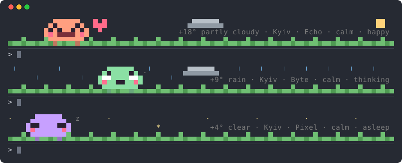

# Claudy Pet

A little pet that lives in the band above the Claude Code prompt. It grows with your work, eats your prompts, cheers when Claude finishes a clean turn, and strolls through a tiny landscape that follows the real weather where you are.





It is a [Claude Code mod](https://code.claude.com/docs/en/plugins/mods/overview): a plugin of TypeScript hooks that runs inside Claude Code.

## Install

In a Claude Code session:

```
/plugin marketplace add KyryloLola/claudy-pet
/plugin install claudy-pet@claudy-pet
```

It draws in the **Claude Code CLI**, the **Code tab of the Claude Desktop app** and, where supported, the **VS Code extension**. Elsewhere its hooks still run and `/pet-stats` prints a text card.

## In the terminal

The CLI gets its own pixel-art band: three rows of half blocks, two pixels to a cell, with the pet, the weather and the grass, and the caption in a zone of its own on the right. Every row is exactly as wide as the terminal, so nothing wraps in any terminal or at any size: a narrower one drops the weather from the caption, then the caption and clouds, and below 18 columns shows one line of text. `/pet-stats` shows the same pixel pet beside its stats.



## What it does

- **Grows** through six stages, Egg → Baby → Kid → Teen → Adult → Legend, from the turns and tools it watches and, slowly, with the calendar: Legend takes a year together.
- **Has a temperament** picked at hatching (calm, energetic, curious, sleepy) that changes how it walks, naps and reacts.
- **Takes a calling** at Teen from the work it saw most: engineer (shell), writer (edits) or explorer (reading and searching).
- **Lives with you**: your prompts feed it, a turn with no tool errors makes it happy, it thinks while Claude thinks, naps when you are away, and only now and then shows that it is hungry or sad.
- **Plays** on its own every few minutes, picking something that fits the weather and the hour: chasing a butterfly, jumping in puddles, rolling a snowball, watching stars.
- **Has golden days**: 25 clean turns in a row, counted across sessions, make it golden until midnight. A turn with a tool error starts the count again.

## A year together

Claudy Pet is meant to keep you company for a long time, in the spirit of slow games where real days pass and small things change. Three modules do it, all on by default and each one switched off with a command or in the `/pet-stats` pane:

- **longing**: stages wait on the pet's age as well as its work. Kid at a week, Teen at a month, Adult at three months, Legend after a year.
- **world**: a home grows by the tree over the days you work together: a bench after a week, the frame of a cottage after a month, the cottage after two, with a light in the window at night. A small garden grows by the bush.
- **seasons**: blossom in spring, turning leaves and fallen ones in autumn, a dull green in a snowless winter, the hemisphere taken from the rough location the weather already uses (north when weather is off). One small piece on fixed-date holidays: New Year, Valentine's Day, Earth Day, Halloween, Christmas, and the pet's own birthday from its second year.

Each piece has one place and replaces the one before it, so the band stays calm. Nothing new animates: these pieces are drawn still and change at most once a day.



## Commands

| Command | What it does |
| --- | --- |
| `/pet-stats` | Opens a pane with the pet, its stats, actions, skins and settings |
| `/pet-feed` | Gives it a snack |
| `/pet-pat` | Gives it a pat |
| `/pet-hide`, `/pet-show` | Removes it from the band, or brings it back |
| `/pet-name <name>` | Renames it |
| `/pet-hatch` | Retires it to the album and hatches a new egg |
| `/pet-caption on\|off` | The weather and mood caption on the band |
| `/pet-weather on\|off` | Real weather, or a calm sky that follows the time of day |
| `/pet-plays on\|off` | Strolls and plays, or a pet that stays calmly in place |
| `/pet-longing on\|off` | Grows with the calendar too, Legend after a year, or by work alone |
| `/pet-world on\|off` | A home and a garden that grow over the days you work together |
| `/pet-seasons on\|off` | Seasons on the tree, grass and garden, and a small piece on holidays |

Settings and the pet itself are kept across sessions.

## Skins


Pick one in the `/pet-stats` pane. "natural" keeps the colours of each stage.

## What it reads, sends and runs

Claudy Pet is written to be easy to audit. Everything it does outside its own code is listed here.

**What it reads**

- **Your prompt box**, only to tell whether you are typing (so the band can step aside). It looks at whether the text is empty; the text is never stored or sent.
- **Each submitted prompt and each tool call**, only to count them: a prompt feeds the pet, and a tool call adds to its tally of shell, edit and explore work. It reads the tool's name and whether it failed; never its input or output.
- **Each finished turn**: whether it ended normally and its output token count, which turn into experience.
- **The date and time on your computer**, for the pet's age, the days you worked together, the season and holidays.
- **Its own settings and pet**, in the plugin's own store under your Claude Code configuration directory.

**What it sends, and where**

Only when the weather setting is on (it is by default):

- `GET https://ipwho.is/` — returns the city and rough coordinates for your IP address. Like any web request, it reveals your IP address to ipwho.is. The answer is cached and the call made at most twice a day.
- `GET https://api.open-meteo.com/v1/forecast?latitude=…&longitude=…&current=…` — the current weather at those coordinates, rounded to two decimals (about a kilometre). Every 20 minutes.

Nothing about your prompts, tool calls, files, code or conversation is ever sent anywhere. `/pet-weather off` stops both requests.

**Every hook it registers, and what it does with what it sees**

| Hook | What it does |
| --- | --- |
| `session.start`, `session.end` | Brings the pet back from its store, starts its timers; saves the pet when the session ends |
| `prompt.edit` | Checks only whether the prompt box is empty, to hide the band while you type |
| `prompt.submit` | Counts the prompt as food; the text is not read beyond that |
| `tool.call` | Counts the tool by name and notes whether it failed; never changes, blocks or answers a call |
| `turn.complete` | Turns the finished turn and its output token count into experience |
| `command.run` | Answers only its own commands, each matched by its exact name (`pet-stats`, `pet-feed`, `pet-pat`, `pet-show`, `pet-hide`, `pet-hatch`, `pet-name`, `pet-caption`, `pet-weather`, `pet-plays`); it never sees, changes or runs any other command |
| `ui.render` | Draws the band above the prompt and the `/pet-stats` pane |

**What it runs**

Nothing. It starts no processes, runs no shell commands, calls no tools and no models, and reads no environment variables, credentials, tokens or files outside its own store. Its `tool.call` hook only observes calls to count them, and always lets them run unchanged. It adds the `/pet-*` commands listed above, each of which only changes the pet or its settings.

Like every mod, Claudy Pet runs with your permissions; you can confirm all of the above with `claude plugin validate <path-to-a-clone>`, which lists every hook and call the mod makes.

See also [PRIVACY.md](PRIVACY.md).

## How it stays light

The band is one SVG picture whose source only changes when something you can see changes, so the surface keeps it running instead of reloading it; loops are phased to the moment the picture was first drawn. The scene has only a handful of animations, rain and snow move as single sheets, and a session nobody is looking at goes dormant. In a terminal the band redraws once a second, four times a second while the pet walks, and stops as soon as no terminal is drawing it. The year-together modules add no timer: age, days, season and holiday are read from the date when the band is rebuilt anyway.

## Develop

```
git clone https://github.com/KyryloLola/claudy-pet
claude plugin validate claudy-pet
claude plugin test claudy-pet
claude --plugin-dir claudy-pet
```

## License

MIT
